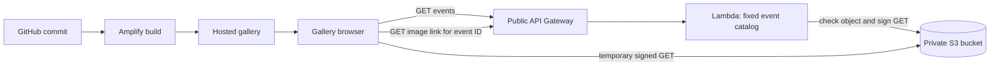

<!-- markdownlint-disable MD003 MD010 MD012 MD022 MD024 MD025 MD036 MD041 MD060 -->

# Module 4 Tutorial 7: Build and Deploy an Events Gallery

## Purpose

Build a small Yarrow-Mullein Bank (YMB) events gallery using HTML, JavaScript, CSS, API Gateway, Lambda, private S3 storage, and Amplify Hosting. Students browse two synthetic workshops and load their images through short-lived presigned S3 URLs.

**Tutorial question:** How can a browser display images from a private bucket, explain request failures, and prove which source change is deployed?

**Duration:** Approximately 2.5-3 hours with an instructor-prepared backend. Allow extra time if provisioning resources yourself.

**Scope:** This is a read-only public gallery. There is no login, identity provider, user-specific data, or enrollment workflow. Event metadata is a small server-side fixture; no database is needed. This is not Assignment 5's customer-service application.

**Important access distinction:** The S3 bucket is private, but the gallery API is public. Anyone who can call the API can obtain a temporary read URL for either gallery image. This demonstrates signed S3 access, not user authorization. Use only harmless synthetic images, never confidential content. CORS is not access control.

## Learning objectives

By the end of this tutorial, you should be able to:

- trace a gallery request from browser to API Gateway to Lambda;
- distinguish loading, empty, success, and error states;
- explain object keys, execution-role permissions, presigned URLs, and S3 CORS separately; and
- connect a GitHub commit to an Amplify deployment and a working hosted gallery.

## Before you start

You need a text editor, Python 3, a browser with developer tools, and AWS Academy Learner Lab access. Use the **existing, pre-configured `LabRole`** as Lambda's execution role. 

API Gateway invocation permission is separate from the execution role. The `aws lambda add-permission` command below adds a narrowly scoped statement to the new Lambda function's resource-based policy; it does not create or change an IAM role or IAM identity policy. If your course also prohibits changes to function resource policies, the instructor must preconfigure that invocation permission and students must skip that command.

This folder contains the gallery tutorial, two supplied images (`trn001.png` and `trn002.png`), its runnable source files (`src/lambda_function.py` and the four files in `gallery-frontend`), Python unit tests in `tests`, and API Gateway test-event JSON files in `events`. The source files match the code walkthrough below; students can inspect them or recreate them as they follow the instructions. 

Run the following from the `lab7` directory:

```bash
set -euo pipefail
mkdir -p gallery-work gallery-frontend
cd gallery-work
export AWS_DEFAULT_REGION="${AWS_DEFAULT_REGION:-us-east-1}"
export AWS_ACCOUNT_ID="$(aws sts get-caller-identity --query Account --output text)"
export LAB_ROLE_ARN="$(aws iam get-role --role-name LabRole --query Role.Arn --output text)"
export GALLERY_FUNCTION="ymb-events-gallery-lab7"
export GALLERY_API_NAME="ymb-events-gallery-lab7"
export IMAGE_BUCKET="ymb-gallery-lab7-${AWS_ACCOUNT_ID}-${AWS_DEFAULT_REGION}-$(date +%s)"
export FRONTEND_ORIGIN="http://localhost:8080"
```

The timestamp makes the bucket name unique. Create the resources once; on later terminals, load the saved configuration instead of regenerating names.

## Architecture and API contract



| Request | Result |
| --- | --- |
| `GET /events` | `200`, `{"events":[{"eventId":"TRN001","title":"...","description":"...","imageAlt":"..."}]}` |
| `GET /events/TRN001/image` | `200`, `{"imageUrl":"<temporary URL>","expiresIn":300}` |
| `GET /events/UNKNOWN/image` | `404`, safe JSON error |
| Image request when the configured object is missing | `404`, safe JSON error |
| Image request when S3 access fails | `500`, safe JSON error |

The browser supplies an event ID, **not a bucket name or arbitrary object key**. Lambda maps the ID to a known image key. Only the Lambda execution role receives AWS permissions. Never put AWS credentials into the frontend.

**Prediction checkpoint:** If the bucket is private but the image-link API is public, who can view the gallery images?

## Part 1: Prepare two private S3 images

### 1. Upload the supplied images

Use the supplied `trn001.png` and `trn002.png` in the `lab7` directory; no image-generation program is needed. Run these commands from `gallery-work` to create a new bucket, block public access, and upload both images:

```bash
test -f ../trn001.png
test -f ../trn002.png
if [[ "$AWS_DEFAULT_REGION" == "us-east-1" ]]; then
  aws s3api create-bucket --bucket "$IMAGE_BUCKET"
else
  aws s3api create-bucket --bucket "$IMAGE_BUCKET" \
    --create-bucket-configuration "LocationConstraint=$AWS_DEFAULT_REGION"
fi
aws s3api put-public-access-block --bucket "$IMAGE_BUCKET" \
  --public-access-block-configuration \
  BlockPublicAcls=true,IgnorePublicAcls=true,BlockPublicPolicy=true,RestrictPublicBuckets=true
for event in trn001 trn002; do
  aws s3api put-object --bucket "$IMAGE_BUCKET" --key "events/$event.png" \
    --body "../$event.png" --content-type image/png \
    --cache-control "private, no-store" >/dev/null
done
```

Do not add a public bucket policy or object ACL. If bucket creation fails, resolve the reported error before uploading.

### 2. Configure S3 CORS and verify privacy

The browser will fetch the signed image bytes in JavaScript. Allow its exact origin to read the response:

```bash
aws s3api put-bucket-cors --bucket "$IMAGE_BUCKET" --cors-configuration "{
  \"CORSRules\": [{
    \"AllowedOrigins\": [\"$FRONTEND_ORIGIN\"],
    \"AllowedMethods\": [\"GET\"],
    \"MaxAgeSeconds\": 300
  }]
}"
aws s3api head-object --bucket "$IMAGE_BUCKET" --key events/trn001.png \
  --query '{ContentType:ContentType,Size:ContentLength}'
aws s3api get-public-access-block --bucket "$IMAGE_BUCKET"
curl -sS -o /dev/null -w 'Unsigned S3 request: HTTP %{http_code}\n' \
  "https://${IMAGE_BUCKET}.s3.${AWS_DEFAULT_REGION}.amazonaws.com/events/trn001.png"
```

Expected: `image/png`, all four public-access-block settings `true`, and unsigned HTTP `403`. A CORS rule does not make a private object public.

## Part 2: Build a small public gallery API

### 1. Add the Lambda handler

Create or inspect `src/lambda_function.py`. This is an independent handler for the gallery.

```python
import json
import logging
import os

import boto3
from botocore.config import Config
from botocore.exceptions import BotoCoreError, ClientError

logger = logging.getLogger()
logger.setLevel(logging.INFO)
region = os.environ["AWS_REGION"]
bucket = os.environ["IMAGE_BUCKET"]
s3 = boto3.client(
    "s3", region_name=region,
    endpoint_url=f"https://s3.{region}.amazonaws.com",
    config=Config(signature_version="s3v4", s3={"addressing_style": "virtual"}),
)

# Only these synthetic events and keys can be requested.
EVENTS = {
    "TRN001": {
        "eventId": "TRN001",
        "title": "Cloud foundations workshop",
        "description": "Explore a browser-to-cloud request.",
        "imageAlt": "Teal checkerboard banner for the cloud foundations workshop",
        "imageKey": "events/trn001.png",
    },
    "TRN002": {
        "eventId": "TRN002",
        "title": "Accessible interfaces workshop",
        "description": "Practise keyboard navigation and useful image descriptions.",
        "imageAlt": "Purple checkerboard banner for the accessible interfaces workshop",
        "imageKey": "events/trn002.png",
    },
}


def response(status, body):
    return {
        "statusCode": status,
        "headers": {
            "Content-Type": "application/json",
            "Access-Control-Allow-Origin": "*",
            "Cache-Control": "no-store",
        },
        "body": json.dumps(body),
    }


def lambda_handler(event, context):
    resource = event.get("resource")
    if event.get("httpMethod") != "GET":
        return response(405, {"message": "Only GET is supported"})
    if resource == "/events":
        # Keep the internal S3 mapping on the server.
        items = [
            {key: value for key, value in item.items() if key != "imageKey"}
            for item in EVENTS.values()
        ]
        return response(200, {"events": items})
    if resource != "/events/{eventId}/image":
        return response(404, {"message": "Route not found"})

    event_id = (event.get("pathParameters") or {}).get("eventId")
    item = EVENTS.get(event_id)
    if item is None:
        return response(404, {"message": "Event not found"})
    try:
        s3.head_object(Bucket=bucket, Key=item["imageKey"])
        image_url = s3.generate_presigned_url(
            "get_object",
            Params={"Bucket": bucket, "Key": item["imageKey"]},
            ExpiresIn=300,
        )
    except ClientError as error:
        code = error.response.get("Error", {}).get("Code", "Unknown")
        # S3 may return 403, not 404, when the role lacks ListBucket permission.
        if code in {"404", "NoSuchKey", "NotFound"}:
            return response(404, {"message": "Event image not found"})
        logger.error("image_access_failed event_id=%s code=%s", event_id, code)
        return response(500, {"message": "Unable to access event image"})
    except BotoCoreError as error:
        logger.error("image_request_failed type=%s", type(error).__name__)
        return response(500, {"message": "Unable to access event image"})
    # Never log the signed URL or include it in collected evidence.
    return response(200, {"imageUrl": image_url, "expiresIn": 300})
```

Check the supplied images and update each event's `imageAlt` in `src/lambda_function.py` to describe its actual content; the checkerboard descriptions above are examples.

The API response allows cross-origin public GET requests. The frontend sends no custom request headers, so these simple GET requests do not require an OPTIONS preflight. S3 has its own separate CORS rule.

### 2. Deploy the Lambda

From `gallery-work`, package only the new handler. These commands create a **new** function using the existing `LabRole` ARN in `--role`; they create no IAM roles or identity policies. If the function name already exists, stop and confirm ownership instead of overwriting it.

```bash
python3 -m zipfile -c function.zip ../src/lambda_function.py
aws lambda create-function \
  --function-name "$GALLERY_FUNCTION" --runtime python3.14 \
  --role "$LAB_ROLE_ARN" --handler lambda_function.lambda_handler \
  --zip-file fileb://function.zip --timeout 15 \
  --environment "Variables={IMAGE_BUCKET=$IMAGE_BUCKET}" >/dev/null
aws lambda wait function-active-v2 --function-name "$GALLERY_FUNCTION"
export GALLERY_LAMBDA_ARN="$(aws lambda get-function \
  --function-name "$GALLERY_FUNCTION" --query Configuration.FunctionArn --output text)"
```

If you later edit this handler, deploy the new ZIP using `update-function-code` and wait for `function-updated-v2`. A local edit alone does not update AWS.

### 3. Create the REST API routes

Create a separate API with two public GET integrations. No identity provider or user-pool authorizer is involved. The `add-permission` step allows only GET requests from this API to invoke the gallery function. It does not grant S3 access; `LabRole` has a broad S3 access policy attached.

```bash
export GALLERY_API_ID="$(aws apigateway create-rest-api \
  --name "$GALLERY_API_NAME" --query id --output text)"
ROOT_ID="$(aws apigateway get-resources --rest-api-id "$GALLERY_API_ID" \
  --query "items[?path=='/'].id | [0]" --output text)"
EVENTS_ID="$(aws apigateway create-resource --rest-api-id "$GALLERY_API_ID" \
  --parent-id "$ROOT_ID" --path-part events --query id --output text)"
EVENT_ID="$(aws apigateway create-resource --rest-api-id "$GALLERY_API_ID" \
  --parent-id "$EVENTS_ID" --path-part '{eventId}' --query id --output text)"
IMAGE_ID="$(aws apigateway create-resource --rest-api-id "$GALLERY_API_ID" \
  --parent-id "$EVENT_ID" --path-part image --query id --output text)"
for resource in "$EVENTS_ID" "$IMAGE_ID"; do
  aws apigateway put-method --rest-api-id "$GALLERY_API_ID" \
    --resource-id "$resource" --http-method GET --authorization-type NONE >/dev/null
  aws apigateway put-integration --rest-api-id "$GALLERY_API_ID" \
    --resource-id "$resource" --http-method GET --type AWS_PROXY \
    --integration-http-method POST \
    --uri "arn:aws:apigateway:${AWS_DEFAULT_REGION}:lambda:path/2015-03-31/functions/${GALLERY_LAMBDA_ARN}/invocations" >/dev/null
done
aws lambda add-permission --function-name "$GALLERY_FUNCTION" \
  --statement-id gallery-api --action lambda:InvokeFunction \
  --principal apigateway.amazonaws.com \
  --source-arn "arn:aws:execute-api:${AWS_DEFAULT_REGION}:${AWS_ACCOUNT_ID}:${GALLERY_API_ID}/*/GET/*" >/dev/null
aws apigateway create-deployment --rest-api-id "$GALLERY_API_ID" \
  --stage-name dev >/dev/null
export GALLERY_API_URL="https://${GALLERY_API_ID}.execute-api.${AWS_DEFAULT_REGION}.amazonaws.com/dev"

# Save resource identifiers, not credentials or signed URLs.
cat > gallery.env <<EOF
export AWS_DEFAULT_REGION="$AWS_DEFAULT_REGION"
export AWS_ACCOUNT_ID="$AWS_ACCOUNT_ID"
export IMAGE_BUCKET="$IMAGE_BUCKET"
export GALLERY_FUNCTION="$GALLERY_FUNCTION"
export GALLERY_API_ID="$GALLERY_API_ID"
export GALLERY_API_URL="$GALLERY_API_URL"
export FRONTEND_ORIGIN="$FRONTEND_ORIGIN"
EOF
```

Record each created resource ID as you go. If provisioning stops before `gallery.env` is written, record the successful resources for cleanup; do not rerun the entire block and create another API.

### 4. Verify the contract

```bash
curl -fsS "$GALLERY_API_URL/events" | python3 -m json.tool
curl -sS -o /dev/null -w 'Unknown event: HTTP %{http_code}\n' \
  "$GALLERY_API_URL/events/UNKNOWN/image"
curl -fsS "$GALLERY_API_URL/events/TRN001/image" \
  | python3 -c 'import json,sys; data=json.load(sys.stdin); print("URL received:", isinstance(data.get("imageUrl"), str), "expiresIn:", data.get("expiresIn"))'
```

Expected: two events, unknown event HTTP `404`, and `URL received: True expiresIn: 300`. Do not print or save the full image-link response.

**Verification checkpoint:** Explain why the API succeeds without a login while an unsigned S3 request fails.

### 5. Run offline unit tests

From `lab7`, run the tests using Python's built-in `unittest` runner:

```bash
python3 -m unittest discover -s tests -v
```

The Lambda tests require `boto3`, which Lambda provides at runtime but your local Python environment must also have installed (`python3 -m pip install boto3` if missing). No additional test framework is needed. AWS calls are mocked, and the real presigner is tested with fake credentials without sending requests.

The tests cover the public catalog, empty results, routing, fixed image keys, five-minute signed URL shape, missing objects, S3 errors, and safe logging. These offline checks do not replace browser CORS or deployed-resource verification.

The `events/lambda` folder contains simplified API Gateway REST API events for the Lambda console's **Test** tab. Paste a JSON file into a test event: `list_events.json` and the two known-image events return `200`; unknown event, missing event ID, and unknown route return `404`; `unsupported_method.json` returns `405`. The unit suite also replays all seven files. Missing-object and S3-access failures are simulated separately in the unit tests.

Console image tests call real S3 using the Lambda's configured bucket and role. Their successful output contains a signed URL: do not copy it into screenshots or reports. These console tests bypass API Gateway and do not verify its integration or browser CORS.

### 6. Test the deployed API Gateway

The JSON files in `events/apigateway` describe actual HTTP requests and expected responses, not Lambda invocation payloads. They cover the event list, both image links, an unknown event, an unknown route, and an unsupported method. The runner sends their method and path to the deployed API; do not POST the fixture JSON as a request body.

From `lab7`, run:

```bash
source ./gallery-work/gallery.env
python3 -m unittest discover -s tests -p test_api_gateway.py -v
```

These tests make live requests and require the dedicated gallery deployment and both S3 objects. They are skipped when `GALLERY_API_URL` is unset, so ordinary offline unit tests need no deployed API. The runner checks response shapes, image keys, link lifetime, and API response headers without printing signed URLs. It does not download the images or verify browser S3 CORS.

For this REST API, an unknown route or unconfigured POST method returns API Gateway's `403` with `Missing Authentication Token`, even though this gallery requires no authentication. Those requests do not reach Lambda. Direct Lambda fixtures instead return `404` for an unknown route and `405` for unsupported methods. The live cases assume the default Gateway error responses shown in this tutorial.

## Part 3: Build the browser events gallery

Create or inspect the following files in `lab7/gallery-frontend`. Set its own public API configuration.

### 1. HTML and responsive CSS

Create `index.html`:

```html
<!doctype html>
<html lang="en">
<head>
  <meta charset="utf-8">
  <meta name="viewport" content="width=device-width, initial-scale=1">
  <title>YMB events gallery</title>
  <link rel="stylesheet" href="./styles.css">
  <script type="module" src="./app.js"></script>
</head>
<body>
  <main>
    <h1>YMB events gallery</h1>
    <p>Browse synthetic workshops and their images from private S3 storage.</p>
    <button id="refresh" type="button">Refresh gallery</button>
    <p id="status" role="status" aria-live="polite">Ready to load events.</p>
    <ul id="gallery" aria-label="Training events"></ul>
  </main>
</body>
</html>
```

Create `styles.css`:

```css
* { box-sizing: border-box; }
body { margin: 0; font-family: system-ui, sans-serif; color: #172554; background: #f8fafc; }
main { max-width: 1100px; margin: auto; padding: 1.5rem; }
button { padding: .7rem 1rem; cursor: pointer; }
button:disabled { cursor: wait; }
:focus-visible { outline: 3px solid #4338ca; outline-offset: 3px; }
#gallery { list-style: none; padding: 0; display: grid; gap: 1rem;
  grid-template-columns: repeat(auto-fit, minmax(min(100%, 280px), 1fr)); }
#gallery li { border: 1px solid #cbd5e1; border-radius: .5rem; padding: 1rem; background: white; }
img { display: block; width: 100%; height: auto; border-radius: .4rem; }
[hidden] { display: none !important; }
```

### 2. Public API configuration

Create `config.js`, replacing the example with `GALLERY_API_URL` from `gallery-work/gallery.env`:

```javascript
// This is a public endpoint, not an AWS credential.
export const API_URL = "https://YOUR_API_ID.execute-api.us-east-1.amazonaws.com/dev";
```

### 3. Fetch events and display their S3 images

Create `app.js`:

```javascript
import { API_URL } from "./config.js";

const gallery = document.getElementById("gallery");
const status = document.getElementById("status");
const refresh = document.getElementById("refresh");
const objectUrls = new Set();
let controller;

function clearGallery() {
  // Cancel a previous request and release local image bytes on refresh or exit.
  controller?.abort();
  for (const url of objectUrls) URL.revokeObjectURL(url);
  objectUrls.clear();
  gallery.replaceChildren();
}

async function requestApi(path, signal) {
  let response;
  try {
    response = await fetch(`${API_URL}${path}`, {
      signal, credentials: "omit", cache: "no-store",
    });
  } catch (error) {
    if (signal.aborted) throw error;
    throw new Error("Cannot reach the gallery API. Check the URL, deployment, and API CORS.");
  }
  if (!response.ok) throw new Error(`Gallery API returned HTTP ${response.status}.`);
  try {
    return await response.json();
  } catch {
    throw new Error("The gallery API returned invalid JSON.");
  }
}

async function loadImage(event, row, signal) {
  const message = document.createElement("p");
  message.textContent = "Loading image...";
  row.append(message);
  try {
    const data = await requestApi(`/events/${encodeURIComponent(event.eventId)}/image`, signal);
    let signedUrl;
    try {
      signedUrl = new URL(data.imageUrl);
    } catch {
      throw new Error("The API returned an invalid image URL.");
    }
    if (signedUrl.protocol !== "https:" || !signedUrl.hostname.endsWith(".amazonaws.com")) {
      throw new Error("The API returned an unexpected image address.");
    }
    let response;
    try {
      // No AWS keys, custom headers, or cookies: the signature grants this read.
      response = await fetch(signedUrl, {
        signal, credentials: "omit", cache: "no-store", referrerPolicy: "no-referrer",
      });
    } catch (error) {
      if (signal.aborted) throw error;
      throw new Error("Cannot read the S3 image. Check the network and S3 CORS origin.");
    }
    if (!response.ok) throw new Error(`S3 returned HTTP ${response.status}. Refresh for a new link.`);
    const blob = await response.blob();
    if (!["image/png", "image/jpeg", "image/webp"].includes(blob.type)) {
      throw new Error("S3 did not return a supported image type.");
    }
    if (signal.aborted) return;
    const image = document.createElement("img");
    image.alt = event.imageAlt;
    const localUrl = URL.createObjectURL(blob);
    objectUrls.add(localUrl);
    image.src = localUrl;
    try {
      await image.decode();
    } catch {
      URL.revokeObjectURL(localUrl);
      objectUrls.delete(localUrl);
      throw new Error("The image bytes could not be displayed.");
    }
    if (signal.aborted) return;
    row.append(image);
    message.textContent = "Image loaded from private S3 storage.";
  } catch (error) {
    // Cancellation is intentional; all other errors remain visible on their card.
    if (!signal.aborted) message.textContent = error.message;
  }
}

async function loadGallery() {
  clearGallery();
  controller = new AbortController();
  const { signal } = controller;
  refresh.disabled = true;
  status.textContent = "Loading events...";
  try {
    const data = await requestApi("/events", signal);
    if (!Array.isArray(data.events) || data.events.some((event) =>
      !event || ["eventId", "title", "description", "imageAlt"].some((key) =>
        typeof event[key] !== "string" || !event[key].trim()))) {
      throw new Error("Unexpected event data from the gallery API.");
    }
    if (signal.aborted) return;
    if (data.events.length === 0) {
      status.textContent = "No events are available.";
      return;
    }
    const imageRequests = data.events.map((event) => {
      const row = document.createElement("li");
      const heading = document.createElement("h2");
      const description = document.createElement("p");
      // textContent treats API text as text, never executable markup.
      heading.textContent = event.title;
      description.textContent = event.description;
      row.append(heading, description);
      gallery.append(row);
      return loadImage(event, row, signal);
    });
    await Promise.all(imageRequests);
    if (!signal.aborted) {
      status.textContent = `${data.events.length} events listed. Check each card for image results.`;
    }
  } catch (error) {
    if (!signal.aborted) status.textContent = error.message;
  } finally {
    if (!signal.aborted) refresh.disabled = false;
  }
}

refresh.addEventListener("click", loadGallery);
window.addEventListener("pagehide", clearGallery);
// Restore the gallery if the browser returns to this page from its back/forward cache.
window.addEventListener("pageshow", (event) => { if (event.persisted) loadGallery(); });
loadGallery();
```

The browser uses a local `blob:` URL for each image, not the S3 signature in the image's `src`. This avoids putting the signed URL in the page markup; it still appears in developer tools' network requests, so redact query strings. A blob already downloaded can remain visible after its signed URL expires. Expiry prevents later S3 requests; it cannot recall downloaded bytes.

### 4. Run and verify

From `lab7/gallery-frontend`:

```bash
python3 -m http.server 8080 --bind 127.0.0.1
```

Open `http://localhost:8080/`. On EC2 through VS Code Remote SSH, forward port 8080 in the **Ports** panel. Serve only this frontend folder, not `gallery-work` or environment files. Opening the HTML with `file://` is unsupported.

Expected: two event cards and two images. In developer tools, trace:

1. `GET /events`, HTTP `200`;
2. one `GET /events/{eventId}/image` per card, HTTP `200`;
3. one signed S3 GET per card, HTTP `200`, `Content-Type: image/png`; and
4. S3 `Access-Control-Allow-Origin` matching `http://localhost:8080`.

Record methods, paths, status codes, and visible states only. Never copy signed query strings.

| Test | Expected evidence |
| --- | --- |
| Normal gallery load | Two cards, two decoded images, descriptive alt text |
| Refresh | New image links; old local blob URLs released |
| Unknown event ID via curl | API `404`, not an empty event list |
| API URL temporarily set to an unreachable address | Visible API error, not "No events" |
| Instructor-prepared empty event response | "No events are available" |
| Temporary S3 CORS origin mismatch | Cards appear but each image shows an error |
| Restore correct origin and refresh | Images load again |
| Unsigned S3 URL | HTTP `403` |

If testing a CORS mismatch, restore the correct rule from Part 1 afterwards. Browser caching may require a fresh tab or disabled cache. Do not make the bucket public to resolve a browser failure.

**Reflection checkpoint:** Explain why a successful API image-link response does not prove that the S3 request succeeded or that the image rendered.

## Part 4: Deploy the gallery with Amplify Hosting


1. Commit the `gallery-frontend` folder to your repository. Do not commit environment files, ZIP files, signed URLs, or the legacy archive.
2. Push to the intended branch and record the source commit.
3. In Amplify Hosting, connect the repository and branch. Select the static/no-framework workflow and the gallery frontend directory.
4. If a build specification is needed, use the following artifact-only configuration, adjusting the path to the folder's actual location relative to the repository root:

   ```yaml
   version: 1
   frontend:
     phases:
       build:
         commands:
           - echo "Static gallery; no compilation required"
     artifacts:
       baseDirectory: /
       files:
         - '**/*'
   ```

5. Verify the source commit matches the successful build, then open the hosted HTTPS page.
6. Add the **exact hosted origin** to S3 CORS, retaining localhost for local testing. Run from `gallery-work`:

   ```bash
   source ./gallery.env
   export HOSTED_ORIGIN="https://YOUR_BRANCH.YOUR_APP.amplifyapp.com"
   aws s3api put-bucket-cors --bucket "$IMAGE_BUCKET" --cors-configuration "{
     \"CORSRules\": [{
       \"AllowedOrigins\": [\"$FRONTEND_ORIGIN\", \"$HOSTED_ORIGIN\"],
       \"AllowedMethods\": [\"GET\"],
       \"MaxAgeSeconds\": 300
     }]
   }"
   ```

  Another option is to use the AWS Management Console to update the CORS configuration for the S3 bucket. Navigate to the bucket, select the **Permissions** tab, and edit the **CORS configuration** to include the hosted origin.
  ```json
  [
    {
        "AllowedHeaders": [
            "*"
        ],
        "AllowedMethods": [
            "GET"
        ],
        "AllowedOrigins": [
            "http://localhost:8080",
            "https://main.YOUR_APP.amplifyapp.com",
            "https://prod.YOUR_APP.amplifyapp.com"
        ],
        "ExposeHeaders": [],
        "MaxAgeSeconds": 300
    }
  ]```

7. Refresh the hosted page and verify both event metadata and images. A successful Amplify build alone does not prove the browser can read S3.

| Repository | Branch | Commit | Build result | Hosted gallery | API environment |
| --- | --- | --- | --- | --- | --- |
| | | | | | |

**Modification challenge:** Change one event-card style or loading message. Predict the result, verify locally, push, and connect that exact commit to a successful build and the updated hosted gallery.

## Optional extension: Add Cognito sign-in

The core gallery is intentionally public: anyone can request an image-link URL. This optional extension asks you to design and, add a Cognito sign-in flow. 

### Start with the authorization boundary

Choose which operations require a signed-in user before making changes:

- **Recommended learning step:** leave `GET /events` public, but require sign-in for `GET /events/{eventId}/image`. This keeps the gallery catalog visible while limiting who can obtain a new image URL.
- **Stronger private-gallery variant:** protect both API routes if event titles and descriptions are also private.

In either design, remember that a presigned S3 URL is a bearer capability. A user who receives one can share it, and Cognito logout does not revoke a URL that has already been issued. Keep its lifetime short, never log or save it, and use only non-sensitive images in this exercise.

### Plan the changes

1. **Identity provider:** use an instructor-approved Cognito User Pool, public app client (no client secret), and Hosted UI domain. Configure authorization-code sign-in with PKCE. Register exact callback and sign-out URLs for both `http://localhost:8080/` and the Amplify HTTPS origin, as applicable. Create only synthetic learner accounts.
2. **API Gateway:** create a Cognito User Pool authorizer for the gallery REST API and attach it only to the route(s) selected above. Keep `OPTIONS` unauthenticated so the browser can make its CORS preflight. Deploy the REST API stage after changing authorization.
3. **Browser login:** add sign-in and sign-out controls. Use the authorization-code + PKCE flow; validate OAuth `state` and the ID-token `nonce`. Keep the ID token in memory, and keep only the short-lived pending PKCE transaction in tab-scoped `sessionStorage`. Do not add a password form, embed a client secret, or store tokens in `localStorage`, page markup, or test fixtures.
4. **Protected fetch:** send the raw Cognito ID token in the `Authorization` header on protected API calls (without a `Bearer ` prefix for this REST API authorizer). Do not send it to S3: the presigned URL authorizes the S3 GET. On sign-out or session expiry, clear the token, abort private requests, and remove displayed private content.
5. **CORS:** an `Authorization` header causes a browser preflight. Configure API Gateway's unauthenticated `OPTIONS` response to allow the exact frontend origin, `GET,OPTIONS`, and the `Authorization,Content-Type` headers. The Lambda proxy response must also return the appropriate `Access-Control-Allow-Origin`. Keep the S3 CORS rule separately configured for the same frontend origin and `GET`; S3 CORS does not validate the Cognito token.

The existing pre-configured `LabRole` remains Lambda's execution role. Cognito's User Pool authorizer and API Gateway method configuration are separate from Lambda's AWS execution permissions.

### Test and explain the result

Use the browser or a local test runner with a short-lived synthetic ID token supplied through a protected environment variable. Never paste a token into a JSON fixture or command that will be saved in shell history.

| Test | Expected result |
| --- | --- |
| Request a protected route while signed out | API Gateway rejects it (`401` or `403`); Lambda is not invoked |
| Sign in, then request the image link | Protected API call succeeds; response still contains only a short-lived URL for the fixed event key |
| Use the URL to fetch from S3 | S3 GET succeeds only while the signature and signing credentials are valid |
| Call the public catalog route (if left public) | It remains available without a token |
| Sign out or let the ID token expire | The browser clears its session and protected controls/content |
| Inspect browser network and logs | No ID token or full presigned URL is copied into evidence |

Explain which component authenticates the user, which component rejects an unauthenticated request, which component signs the S3 URL, and why the URL remains shareable until it expires. Update the API Gateway test cases for the chosen authorization policy without putting real tokens in the `events` folder.

## Troubleshooting

Use **Reproduce -> Gather evidence -> Classify -> Change one thing -> Retest**.

| Symptom | Check |
| --- | --- |
| API returns `500` for image links | Confirm Lambda's `IMAGE_BUCKET`, exact object key, and LabRole S3 permissions. Ask the instructor if access is denied; do not edit IAM policies. |
| Event metadata loads, images fail | Separate the image-link API response, S3 status, CORS headers, content type, and decoding result. |
| S3 signed GET returns `403` | Refresh for a new URL; check execution-role read permissions and temporary AWS credential expiry. A presigned URL may expire earlier than 300 seconds if its signing credentials expire. |
| Browser reports network/CORS failure | Check the API URL and stage, local/hosted origin, and S3 CORS rule. API Gateway-generated errors may not contain CORS headers. |
| API returns unknown-route error | Confirm `/events/{eventId}/image` is integrated and the REST API was deployed after route changes. |
| Gallery appears empty after an error | Verify error responses are shown as errors rather than substituted with an empty array. |
| Build succeeds but hosted images fail | Add the hosted origin to S3 CORS and verify the deployed public API configuration. |
| Lambda console shows an unresolved wildcard API trigger | Verify the actual API integration and request result. Wildcard invocation permissions need not correspond to a literal wildcard resource or ANY method. |

## Assignment readiness

This exercise prepares public API integration, private S3 reads, browser states, and deployment verification. It does **not** implement every Assignment 5 requirement. Read that assignment and its starter independently; implement any required identity checks, protected operations, user-specific records, and write workflows there.

Do not copy this tutorial's public image-link design for confidential images. A confidential application must authorize the requesting user before issuing a link.

## Cleanup

Stop the local server with Ctrl+C. With instructor approval, delete only the **dedicated gallery resources** created here. The archived teardown script is for the previous backend, not this gallery.

From `gallery-work`, load the saved names and check the account:

```bash
set -euo pipefail
source ./gallery.env
CURRENT_ACCOUNT="$(aws sts get-caller-identity --query Account --output text)"
if [[ "$CURRENT_ACCOUNT" != "$AWS_ACCOUNT_ID" \
   || "$GALLERY_FUNCTION" != "ymb-events-gallery-lab7" \
   || "$IMAGE_BUCKET" != "ymb-gallery-lab7-${AWS_ACCOUNT_ID}-${AWS_DEFAULT_REGION}-"* ]]; then
  echo "Account or resource-name mismatch; refusing cleanup." >&2
  exit 1
fi
aws apigateway get-rest-api --rest-api-id "$GALLERY_API_ID" --query '{id:id,name:name}'
```

Confirm that displayed API belongs to this gallery, then run:

```bash
aws apigateway delete-rest-api --rest-api-id "$GALLERY_API_ID"
aws lambda delete-function --function-name "$GALLERY_FUNCTION"
aws s3api delete-object --bucket "$IMAGE_BUCKET" --key events/trn001.png
aws s3api delete-object --bucket "$IMAGE_BUCKET" --key events/trn002.png
aws s3api delete-bucket --bucket "$IMAGE_BUCKET"
```

If the bucket is not empty, inspect its contents and delete only synthetic objects you created; never recursively delete an unknown bucket's contents. Inspect CloudWatch for `/aws/lambda/ymb-events-gallery-lab7` and delete that dedicated log group if present and approved. Delete the dedicated Amplify app through its console after confirming it is not shared. Record completed cleanup and notify the instructor about any remaining resource.

If the previous tutorial's backend is still running, it is separate from this gallery. Its cleanup instructions, teardown script, and saved configuration are preserved in `../lab7-legacy-archive/lab7-starter`. Follow that documented procedure only when approved; its teardown script does not delete the old S3 bucket.

## Exit ticket

1. Why can anyone call this gallery API even though its S3 bucket is private?
2. Which component holds AWS permissions and signs the image URL?
3. What limits the browser to the two known event images?
4. What distinguishes API success, S3 read success, and successful rendering?
5. Why does CORS not grant S3 permission?
6. What happens to already downloaded bytes when a signed URL expires?
7. What evidence connects a hosted gallery to a source commit?
8. In the optional Cognito extension, how does API Gateway decide whether a request to a protected route may reach Lambda?
9. Why should the Cognito ID token be sent to API Gateway but not to S3, and what credential authorizes the S3 request instead?

## References

- [Amazon S3 presigned URLs](https://docs.aws.amazon.com/AmazonS3/latest/userguide/using-presigned-url.html)
- [Amazon S3 CORS](https://docs.aws.amazon.com/AmazonS3/latest/userguide/cors.html)
- [API Gateway Lambda proxy integrations](https://docs.aws.amazon.com/apigateway/latest/developerguide/set-up-lambda-proxy-integrations.html)
- [AWS Amplify Hosting](https://docs.aws.amazon.com/amplify/latest/userguide/welcome.html)
